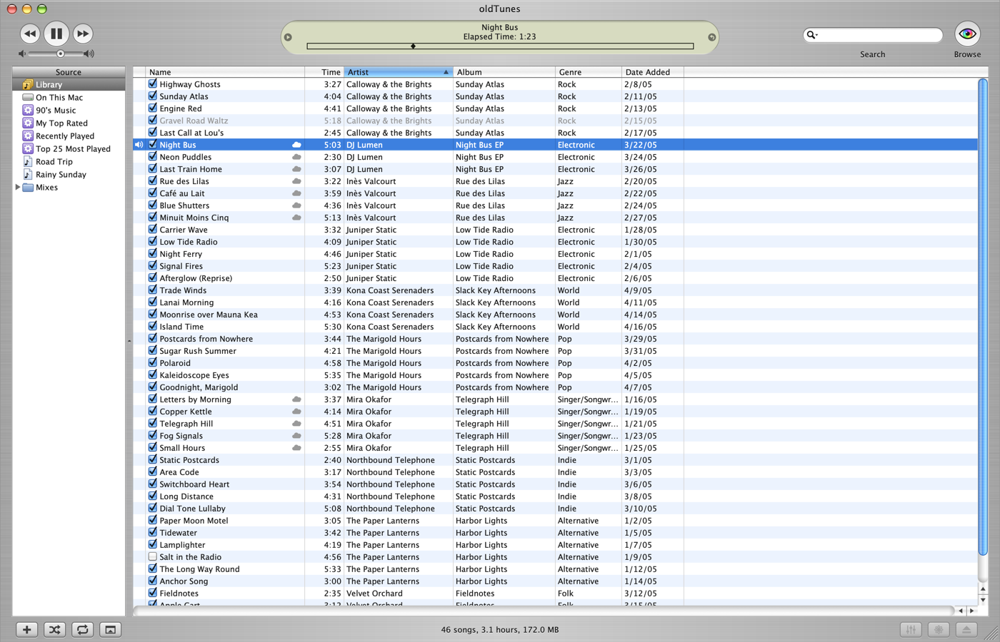

# OldTunes

OldTunes is a music player for your Mac that looks like iTunes did in 2005 (iTunes 4.9, the
brushed-metal one). It plays your whole Apple Music library, including songs that are only in
iCloud and were never downloaded ("iCloud songs" below), plus music files on your Mac.

*Stills from the visualizer, based on Geiss HDR by Ryan Geiss.*

## Get OldTunes

1. Download the newest `OldTunes` zip from the
   [Releases page](https://github.com/rib3ye/OldTunes/releases/latest).
2. Double-click the zip, then drag **OldTunes** into your Applications folder.
3. Open OldTunes. The first time, macOS asks if you're sure you want to open an app from the
   internet. Click **Open**.

To update, do the same with the newer zip and replace the old app.

You need macOS 14 or later (the visualizer needs macOS 14.4). There's nothing to sign in to:
OldTunes uses the Apple Account the Music app already uses on your Mac. To play iCloud songs,
turn on Sync Library in the Music app (Music ▸ Settings ▸ General).

## What macOS asks for, and why

macOS keeps every app away from your music, your other apps and your Mac's sound until you say
yes. OldTunes asks for two things, each only the first time it needs it.

### Media & Apple Music

**When:** the first time you open OldTunes.

**Why:** to see your music library and playlists, and to play your Apple Music and iCloud songs.
Without it, OldTunes can't show your music.

**If you said no:** open System Settings ▸ Privacy & Security ▸ Media & Apple Music and turn on
OldTunes. Then quit and reopen OldTunes: macOS only applies the change after a restart.

### Control the Music app

**When:** the first time you edit a song's details, change a playlist, download a song, or add
songs to the Music app.

**Why:** OldTunes makes those changes through the Music app, so Music and your other devices
show them too. Downloads go through the Music app as well: it does the downloading and keeps the
files in its own folder. If the Music app isn't open when OldTunes needs it, OldTunes opens it
out of sight. OldTunes never uses this to play anything in Music.

**If you said no:** OldTunes can't save those changes or download songs. Turn it on in System
Settings ▸ Privacy & Security ▸ Automation ▸ OldTunes ▸ Music.

### Nothing else

OldTunes doesn't ask for the microphone, Screen Recording or System Audio Recording. Older
versions asked for System Audio Recording to set the volume of iCloud songs. This one sets it
without listening to them. If you allowed it before, you can turn it off: open System Settings ▸
Privacy & Security ▸ Screen & System Audio Recording, and under System Audio Recording Only,
turn off OldTunes.

The visualizer hears the music without any permission. While it's on, macOS counts OldTunes as
sharing its own window, so you may see the screen-sharing icon in the menu bar, and notifications
may wait until you turn the visualizer off.

### Your folders

OldTunes runs in macOS's App Sandbox, the same safety box that apps from the Mac App Store run in.
It can open your Music folder and the folders you pick with Add Folder, and nothing else on your
Mac. Picking a folder is the permission, so there's nothing else to turn on.

- **Updating from an older OldTunes?** Your settings and library come along. Folders you added
  before need picking once more: OldTunes asks when it opens and shows you each one. Click
  **Allow**. Until then their songs show as missing, but nothing is removed.
- **Songs on another drive?** If the Music app keeps your songs outside your Music folder,
  OldTunes plays them from iCloud when it can. If one won't open, add the folder it's in with
  Add Folder.

## What it does

- **Plays your whole library.** Songs on your Mac and iCloud songs play from the same list.
- **Search as you type.** It finds words even from the middle: "nderw" finds "Underworld".
- **Sort.** Click a column title to sort by it, and OldTunes remembers your choice.
- **Shuffle and repeat.** Shuffle the list, and repeat all of it or just one song.
- **Dock menu.** Right-click the Dock icon to see what's playing, pause, skip, shuffle or repeat.
- **Get Info.** See and change a song's details, like its name, artist and album.
- **Checkboxes.** Like in iTunes, unchecked songs are skipped when a list plays or shuffles.
- **Add Folder.** Add folders of music from any drive, and give the songs to Music if you like.
- **On This Mac.** Shows only the songs stored on this Mac.
- **Playlists.** See your Music playlists, make new ones, and rename, copy or delete them.
- **Browse.** Sorts your music by genre, artist and album.
- **Add songs to a playlist.** Drag them onto a playlist, or right-click them and pick one.
- **Remove songs from a playlist.** The songs stay in your library and your other playlists.
- **Download iCloud songs.** Save songs, or a whole playlist, to your Mac.
- **Light or dark.** Choose Light (the 2005 look), Dark, or Match System in Settings.
- **Sound Check.** Plays every song about equally loud, but can't make quiet iCloud songs louder.
- **Its own volume.** The volume slider changes only OldTunes, not your whole Mac.
- **Visualizer.** Based on [Geiss HDR](https://www.geisswerks.com/geiss_hdr) by Ryan Geiss, it turns the music into moving light.

## Keys

| Key | What it does |
|---|---|
| Space | Play or pause (not while you're typing) |
| Keyboard media keys | Play or pause, next song, previous song |
| Return, or double-click | Play the selected song |
| ⌘→ / ⌘← | Next / previous song (⌘← first goes back to the start if the song has played for more than 3 seconds) |
| ⌘↑ / ⌘↓ | Volume up / down |
| → / ← | Next / previous song, like ⌘→ / ⌘←, while a song is on (not while you're typing) |
| ⌥→ / ⌥← | Next / previous album |
| ⌥⌘→ / ⌥⌘← | 5 seconds ahead / back in the song |
| ⌥⌘↓ | Mute, and again to unmute |
| ↑ / ↓, in the visualizer | Volume up / down |
| → / ←, on a playlist folder | Open / close it (with ⌥, every folder inside it too) |
| ⌘F | Search |
| ⌘I | Get Info |
| ⌘B | Show or hide Browse |
| ⌘O | Add Folder |
| ⌘, | Settings |
| ⌘1 | Bring back the window after you close it (the music keeps playing) |
| ⌘T | Visualizer on or off |
| ⇧⌘F | Visualizer full screen (Esc comes back) |
| H | The visualizer's own keys, while it shows |
| ⌘N | New playlist |
| ⇧⌘N | New playlist with the selected songs |
| Return, on a playlist | Rename it (Esc cancels) |
| Delete, on a playlist | Delete it (OldTunes asks first) |
| Delete, on songs in a plain playlist | Remove them from that playlist (OldTunes asks first) |

## What it can't do yet

- **AirPlay.** iCloud songs can't play over AirPlay or crossfade, and the visualizer can't hear
  music that's playing over AirPlay.
- **Smart playlist rules.** You cannot change these rules in OldTunes.
  Copying a long playlist, or adding many songs to one, takes a while.
- **Playlist changes with Music closed.** The normal playlist commands still need the Music app.
  A development prototype uses Apple's private web API. It passed create, rename, add, remove,
  and delete checks on a disposable cloud playlist while Music stayed closed.
  The prototype is not available in the normal interface or release builds yet.
  It still needs a reliable match between local playlists and their cloud IDs.
  See the [prototype status and checks](docs/DEVELOPMENT.md#private-web-playlist-prototype).
- **The equalizer and eject buttons** are only for looks.
- **Songs that are in a playlist twice** show once, and removing one removes every copy.
- **Removing downloads.** Only the Music app can remove a downloaded song.
- **Protected downloads**, like Apple Music songs, still play from iCloud, not from your Mac.

---

Building OldTunes yourself? See [docs/DEVELOPMENT.md](docs/DEVELOPMENT.md).
